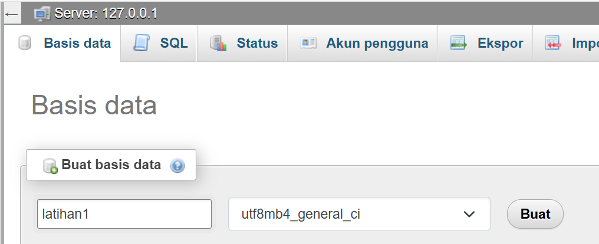
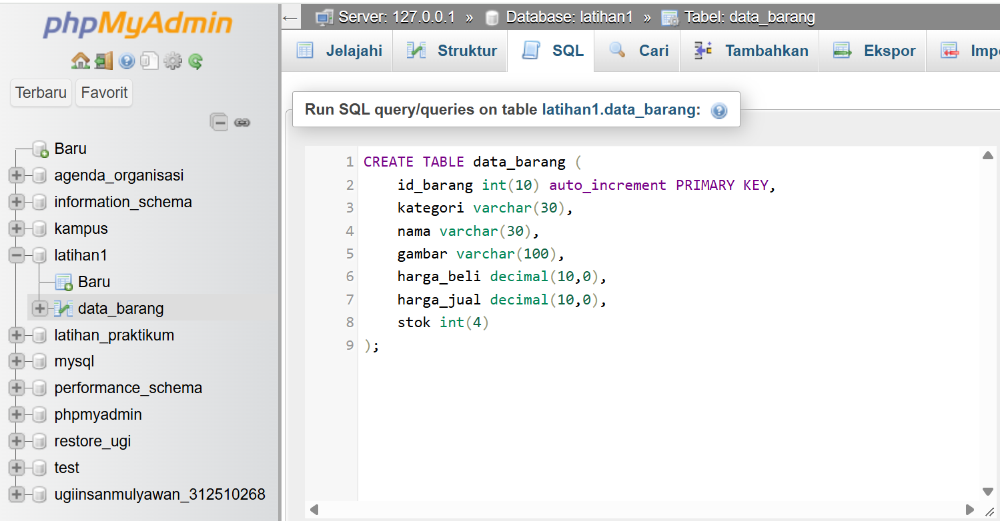
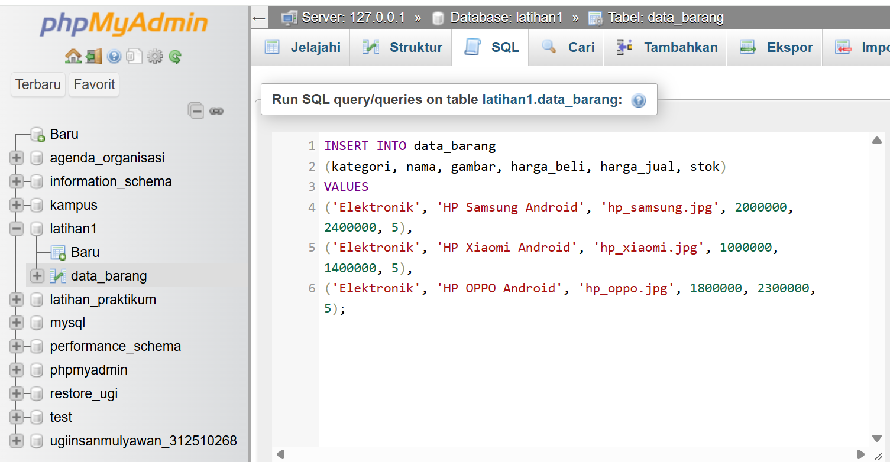
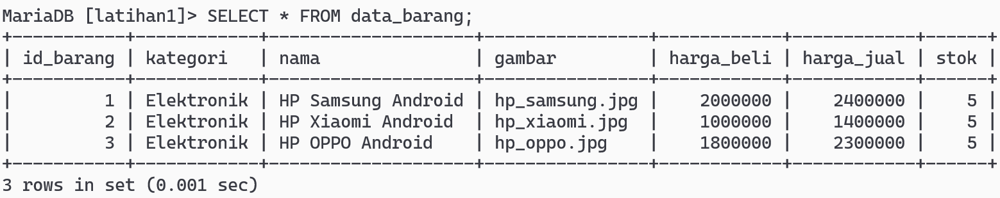
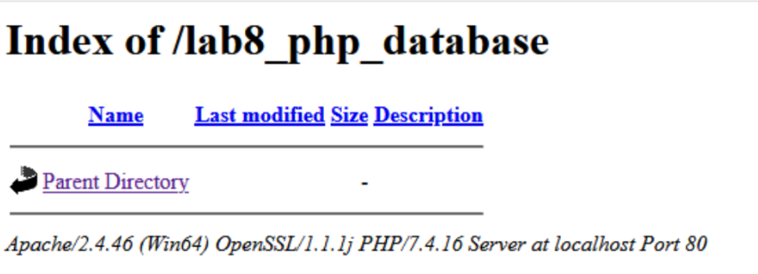

# LAPORAN PRAKTIKUM 8

## PHP DAN DATABASE MYSQL

### Identitas Mahasiswa

* **Nama:** UGI INSAN MULYAWAN
* **NIM:** 312510268
* **Program Studi:** Teknik Informatika
* **Mata Kuliah:** Pemrograman Web
* **Praktikum:** Praktikum 8 --- PHP dan Database MySQL

---

## Pengertian PHP dan Database MySQL

PHP (*Hypertext Preprocessor*) merupakan bahasa pemrograman *server-side* yang dapat berinteraksi langsung dengan sistem manajemen basis data (*Database Management System* / DBMS) seperti MySQL. Integrasi antara PHP dan MySQL memungkinkan pengembang web untuk membangun aplikasi dinamis yang mampu menyimpan, mengelola, dan memanipulasi data secara terstruktur.

Konsep utama dalam pengelolaan data pada aplikasi berbasis web dikenal dengan istilah **CRUD**, yaitu:

* **Create:** Proses menambahkan data baru ke dalam tabel database.
* **Read:** Proses membaca atau menampilkan data yang tersimpan dari database ke halaman web.
* **Update:** Proses memperbarui atau mengubah data yang sudah ada di dalam database.
* **Delete:** Proses menghapus data tertentu dari tabel database.

Pada praktikum ini, diterapkan pembuatan aplikasi CRUD sederhana dengan studi kasus **Data Barang** menggunakan database `latihan1` dan tabel `data_barang` pada server lokal XAMPP.

## Tujuan Praktikum

1. Mahasiswa mampu memahami konsep dasar Database menggunakan MySQL.
2. Mahasiswa mampu menghubungkan aplikasi PHP dengan database MySQL (`mysqli`).
3. Mahasiswa mampu memahami konsep dasar operasi CRUD (*Create, Read, Update, Delete*) menggunakan PHP.
4. Mahasiswa mampu membuat program aplikasi CRUD sederhana studi kasus Data Barang menggunakan PHP dan MySQL.

## Struktur File

Struktur folder praktikum yang digunakan dalam direktori `htdocs` XAMPP adalah sebagai berikut:

```text
Lab8_php_database/
│
├── images/
│
├── hapus.php
├── index.php
├── koneksi.php
├── README.md
├── style.css
├── tambah.php
└── ubah.php
```

**Keterangan:**

* Folder `images/` digunakan untuk menyimpan gambar *screenshot* hasil praktikum sebagai dokumentasi pada laporan ini.
* File `hapus.php` berfungsi untuk menghapus record data barang dari database berdasarkan ID yang dipilih (*Delete*).
* File `index.php` merupakan halaman utama aplikasi yang berfungsi menampilkan seluruh data barang dari database (*Read*).
* File `koneksi.php` berisi konfigurasi untuk menghubungkan script PHP dengan server database MySQL (`latihan1`).
* File `README.md` berisi dokumentasi lengkap mengenai laporan praktikum, penjelasan langkah-langkah, struktur file, serta panduan pengujian program.
* File `style.css` digunakan untuk mengatur tata letak, desain tabel, dan tampilan form pada seluruh halaman aplikasi agar seragam.
* File `tambah.php` digunakan untuk menampilkan formulir dan memproses penambahan data barang baru ke database (*Create*).
* File `ubah.php` digunakan untuk menampilkan formulir edit berdasarkan ID barang dan memperbarui data di database (*Update*).


## Persiapan Praktikum

### 1. Menjalankan MySQL Server dan Apache pada XAMPP

**Pembahasan:**

Untuk memulai pembuatan aplikasi CRUD, langkah pertama yang dilakukan adalah menyiapkan web server dan database server melalui aplikasi **XAMPP Control Panel**. Modul **Apache** dan **MySQL** dijalankan dengan menekan tombol **Start** hingga indikator keduanya berwarna hijau (*running*).

Setelah kedua layanan aktif, antarmuka pengelolaan database **phpMyAdmin** dapat diakses melalui browser pada alamat:

```text
http://localhost/phpmyadmin/
```

### Screenshot XAMPP Control Panel


**Keterangan:**

Apache berjalan pada port 80/443 untuk memproses file PHP, sedangkan MySQL berjalan pada port 3306 sebagai layanan server basis data.

### 2. Membuat Database dan Tabel (Studi Kasus Data Barang)

**Pembahasan:**

Pada phpMyAdmin, dibuat sebuah database baru bernama `latihan1`. Di dalam database tersebut, dibuat tabel bernama `data_barang` dengan struktur field sebagai berikut:

| Nama Field | Tipe Data | Ukuran | Keterangan | 
| :--- | :--- | :--- | :--- | 
| `id_barang` | INT | 10 | Primary Key, Auto Increment | 
| `kategori` | VARCHAR | 30 | Kategori barang | 
| `nama` | VARCHAR | 30 | Nama produk barang | 
| `gambar` | VARCHAR | 100 | Nama/path file gambar | 
| `harga_beli` | DECIMAL | 10,0 | Harga beli barang | 
| `harga_jual` | DECIMAL | 10,0 | Harga jual barang | 
| `stok` | INT | 4 | Jumlah ketersediaan stok | 

Perintah SQL yang dijalankan untuk membuat database, tabel, serta mengisi data awal adalah:

```sql
CREATE DATABASE latihan1;
```


```sql
CREATE TABLE data_barang (
    id_barang int(10) auto_increment Primary Key,
    kategori varchar(30),
    nama varchar(30),
    gambar varchar(100),
    harga_beli decimal(10,0),
    harga_jual decimal(10,0),
    stok int(4)
);
```


```sql
INSERT INTO data_barang (kategori, nama, gambar, harga_beli, harga_jual, stok)
VALUES 
('Elektronik', 'HP Samsung Android', 'hp_samsung.jpg', 2000000, 2400000, 5),
('Elektronik', 'HP Xiaomi Android', 'hp_xiaomi.jpg', 1000000, 1400000, 5),
('Elektronik', 'HP OPPO Android', 'hp_oppo.jpg', 1800000, 2300000, 5);
```

### Screenshot phpMyAdmin & Data Awal





**Keterangan:**

Database `latihan1` beserta tabel `data_barang` berhasil dibuat dan diisi dengan 3 data awal sebagai bahan pengujian aplikasi.

### 3. Membuat Folder Direktori Praktikum

**Pembahasan:**

Selanjutnya dibuat folder proyek baru dengan nama `lab8_php_database` di dalam direktori root web server (`xampp/htdocs/lab8_php_database`). Folder ini dapat diakses melalui browser pada URL:

```text
http://localhost/lab8_php_database/
```

### Screenshot Direktori Project



**Keterangan:**

Direktori `lab8_php_database` siap digunakan untuk menyimpan seluruh file source code PHP, CSS, dan aset gambar.

---

# LANGKAH-LANGKAH PRAKTIKUM

## 1. Membuat File Koneksi Database (`koneksi.php`)

**Pembahasan:**

File `koneksi.php` berfungsi sebagai penghubung antara skrip PHP dengan server MySQL menggunakan fungsi `mysqli_connect()`. Parameter yang dibutuhkan meliputi nama host (`localhost`), username (`root`), password (kosong), dan nama database (`latihan1`).

Jika koneksi gagal, program akan menghentikan eksekusi dengan fungsi `die()` dan menampilkan pesan kesalahan. Untuk menguji koneksi secara langsung, baris komentar `#else echo "Koneksi berhasil";` dapat diaktifkan sementara dan diakses melalui browser.

### Screenshot Codingan


### Hasil Browser


**Keterangan:**

Saat mengakses `http://localhost/lab8_php_database/koneksi.php`, browser menampilkan teks **"Koneksi berhasil"**, yang menandakan PHP telah terhubung dengan database `latihan1`.

## 2. Menampilkan Data / Read (`index.php` dan `style.css`)

**Pembahasan:**

File `index.php` dibuat untuk menampilkan seluruh record data yang ada pada tabel `data_barang`. Proses ini menggunakan perintah query SQL `SELECT * FROM data_barang` yang dieksekusi dengan `mysqli_query()`, kemudian datanya dipecah menggunakan perulangan `while` dan fungsi `mysqli_fetch_array()` ke dalam baris-baris tabel HTML.

Pada halaman ini juga disertakan tautan menuju halaman `tambah.php` untuk menambah data, serta tautan aksi `Ubah` dan `Hapus` pada setiap baris data yang membawa parameter `id_barang` melalui URL. Tampilan halaman diperindah menggunakan file eksternal `style.css`.

### Screenshot Codingan


### Hasil Browser


**Keterangan:**

Halaman utama berhasil menampilkan seluruh data barang dari database ke dalam format tabel HTML lengkap dengan tombol navigasi tambah, ubah, dan hapus data.

## 3. Menambah Data / Create (`tambah.php`)

**Pembahasan:**

File `tambah.php` digunakan untuk menambahkan data barang baru ke dalam database. Halaman ini berisi form HTML dengan atribut `method="post"` dan `enctype="multipart/form-data"` agar form mendukung proses unggah (*upload*) file gambar.

Saat tombol **Simpan** ditekan (`isset($_POST['submit'])`), PHP menangkap seluruh nilai input dari variabel superglobal `$_POST` dan file gambar dari `$_FILES['file_gambar']`. File gambar yang diunggah dipindahkan ke dalam folder `gambar/` menggunakan fungsi `move_uploaded_file()`, lalu seluruh data disimpan ke tabel menggunakan query `INSERT INTO data_barang`. Setelah berhasil, pengguna diarahkan kembali ke halaman utama menggunakan `header('location: index.php')`.

### Screenshot Codingan


### Hasil Browser


**Keterangan:**

Formulir tambah barang berhasil menerima input data baru beserta file gambar, menyimpannya ke dalam tabel `data_barang`, dan langsung memperbarui daftar pada halaman `index.php`.

## 4. Mengubah Data / Update (`ubah.php`)

**Pembahasan:**

File `ubah.php` berfungsi untuk memperbarui data barang yang sudah ada. Pertama, program menangkap parameter `id` dari URL menggunakan `$_GET['id']`, lalu mengambil data lama dari database dengan query `SELECT * FROM data_barang WHERE id_barang = '{$id}'` untuk ditampilkan sebagai nilai awal (*default value*) di dalam form input.

Untuk elemen `<select>` pada pilihan Kategori, digunakan fungsi bantuan `is_select()` agar opsi kategori yang tersimpan sebelumnya otomatis terpilih (*selected*). Ketika pengguna mengirimkan perubahan melalui metode `POST`, program menjalankan perintah SQL `UPDATE data_barang SET ... WHERE id_barang = '{$id}'`. Jika pengguna tidak mengunggah gambar baru, kolom gambar pada database tidak akan ditimpa.

### Screenshot Codingan


### Hasil Browser


**Keterangan:**

Halaman ubah barang berhasil memuat data lama sesuai ID yang dipilih, memproses pembaruan data ke database, dan mengarahkan tampilan kembali ke `index.php`.

## 5. Menghapus Data / Delete (`hapus.php`)

**Pembahasan:**

File `hapus.php` merupakan skrip pemrosesan tanpa antarmuka HTML yang bertugas menghapus satu baris data dari tabel database. Skrip ini menerima parameter `id` barang yang dikirimkan melalui URL (`$_GET['id']`) saat pengguna mengklik tautan **Hapus** di halaman utama.

Program kemudian mengeksekusi perintah query SQL `DELETE FROM data_barang WHERE id_barang = '{$id}'` melalui `mysqli_query()`. Setelah data terhapus dari database, halaman langsung dialihkan kembali ke `index.php`.

### Screenshot Codingan


### Hasil Browser


**Keterangan:**

Data barang yang dipilih berhasil dihapus dari tabel `data_barang` di database dan tidak lagi ditampilkan pada tabel halaman utama.

---

# KESIMPULAN

Berdasarkan hasil pelaksanaan **Praktikum 8: PHP dan Database MySQL**, dapat disimpulkan beberapa hal sebagai berikut:

1. PHP dapat dihubungkan secara langsung dengan server database MySQL menggunakan ekstensi `mysqli` (`mysqli_connect`) untuk melakukan pertukaran dan pengelolaan data secara dinamis.
2. Pembuatan aplikasi CRUD (*Create, Read, Update, Delete*) memisahkan fungsi tiap halaman ke dalam file tersendiri (`koneksi.php`, `index.php`, `tambah.php`, `ubah.php`, dan `hapus.php`) sehingga struktur kode menjadi lebih modular, rapi, dan mudah dipelihara.
3. Penggunaan atribut `enctype="multipart/form-data"` pada form HTML dan variabel superglobal `$_FILES` memungkinkan aplikasi web untuk menangani proses unggah (*upload*) file gambar ke direktori server sekaligus menyimpan nama filenya ke dalam database.
4. Pengiriman parameter identitas data (`id_barang`) melalui metode `GET` pada URL sangat efektif digunakan untuk menargetkan record spesifik pada saat proses pembaruan (*Update*) maupun penghapusan (*Delete*) data.

---

# DOKUMENTASI

Seluruh *screenshot* kode program dan hasil tampilan pada browser telah didokumentasikan secara berurutan pada setiap tahapan praktikum di atas. Sebelum mengunggah proyek ke repository GitHub (`Lab8Web`), pastikan seluruh file gambar dokumentasi telah tersimpan di dalam folder `images/` dengan penamaan yang sesuai agar dapat tampil dengan sempurna pada halaman repository.